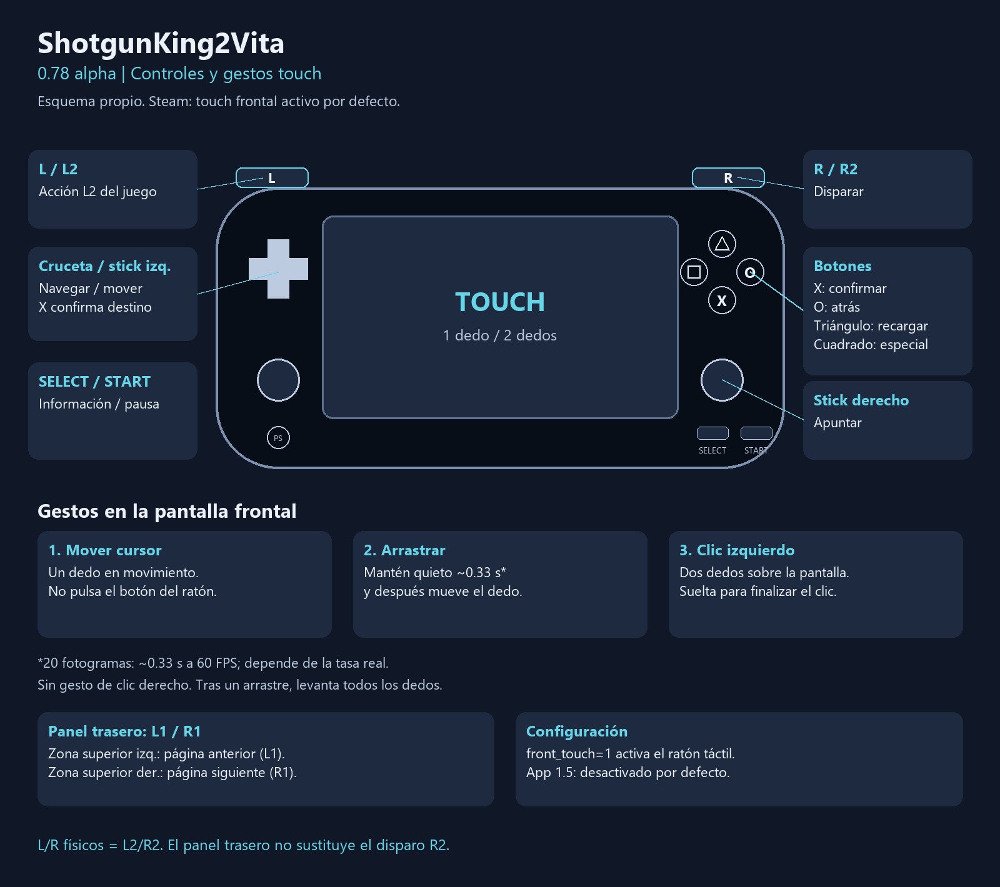
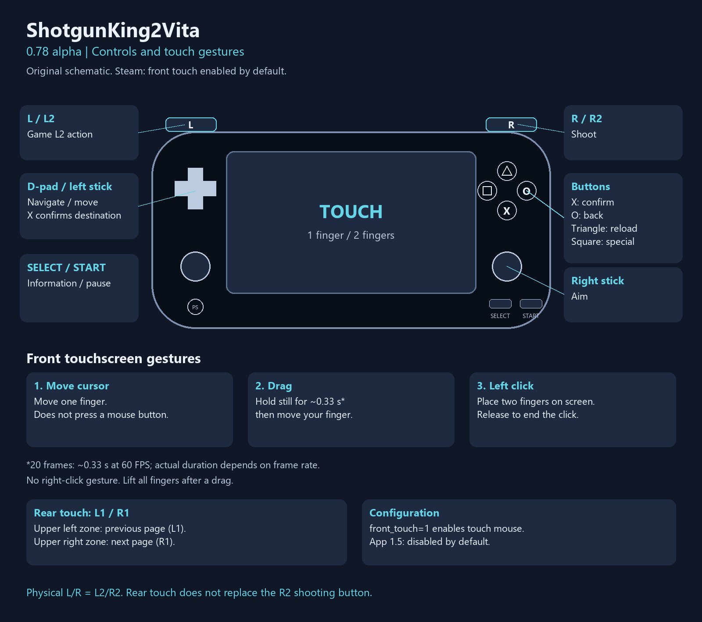

# ShotgunKing2Vita — 0.78 alpha

> **Aviso legal:** proyecto no oficial, sin relación con los autores del juego. No incluye ni distribuye archivos del juego. Requiere una copia **legal y propia**, en la versión correcta: Steam «The Final Checkmate» **1.623b** para la app Steam; datos compatibles **1.5** para la app 1.5. No se da soporte a copias piratas ni a otras versiones.
>
> **Disclaimer:** unofficial project, not affiliated with the game authors. It does not include or distribute game files. You need your **own legally obtained copy**, in the correct version: Steam “The Final Checkmate” **1.623b** for the Steam app; compatible **1.5** assets for the 1.5 app. Pirated copies and other versions are not supported.

[Español](#español) · [English](#english)

## Español

### Versión y apps

Versión pública preparada: **0.78 alpha** (build **00.78**). Runtime homebrew en C que ejecuta Lua/LuaJIT con una implementación parcial de SUGAR. No ejecuta el EXE de Windows ni el binario de Android.

| App | ID | Datos del usuario |
|---|---|---|
| 1.5 | `SGKV00001` | `ux0:data/shotgunk2vita/` |
| Steam The Final Checkmate 1.623b | `SGKV00002` | `ux0:data/shotgunk2vita_steam/` |

El título de LiveArea de Steam es **ShotgunK2Vita**. Ambas apps pueden coexistir. Los VPK no incluyen recursos comerciales ni parches que contengan fragmentos del juego.

### Instalación

1. Instala `ShotgunKing2Vita-steam.vpk` con VitaShell.
2. Crea `ux0:data/shotgunk2vita_steam/` y copia **solo `data.sgr`** desde tu instalación legal de Steam 1.623b.
3. Abre la app: extrae los recursos y prepara las imágenes en el primer arranque. Espera a que termine; no necesitas un APK, Python ni FFmpeg para esta instalación.
4. Para actualizar, instala el VPK conservando la carpeta de datos y `save/`. Respalda tus partidas; no mezcles datasets 1.5/Steam ni importes saves cifrados de PC.

La app 1.5 se instala con `ShotgunKing2Vita-performance.vpk` y requiere sus datos preparados desde un APK compatible del usuario; su VPK no instala el `data.sgr` de Steam. Véase [instalación](docs/INSTALLATION.md).

### Controles y touch

L/R físicos envían L2/R2; R dispara. El panel trasero usa L1/R1 para páginas. Un dedo mueve el cursor; mantenerlo quieto 20 frames y luego moverlo arrastra (~0.33 s a 60 FPS); dos dedos hacen clic izquierdo. No hay gesto de clic derecho. Touch frontal está activo por defecto en Steam y se configura con `front_touch=1`.

### Mods

Copia las carpetas de Workshop a `ux0:data/shotgunk2vita_steam/mods/`. La app las renombra según `info.lua` cuando procede y convierte sus imágenes. Actívalas desde el menú del juego. Para **SGK Extra**, instala también **glac terminal**, **extra features** y **glacies collection**. Usa las versiones The Final Checkmate; no sustituyas `script.lua` por `script1.5.lua`. La compatibilidad completa de estos mods sigue pendiente de aceptación.

### Estado alpha

Hay instalador SGR, audio Vorbis, gráficos, fuentes, controles, guardado diagnóstico y APIs de mods. La cobertura de SUGAR es parcial: servicios online, compatibilidad completa de mods, saves cifrados de Steam, teclado y clic derecho no están soportados. Compilar o pasar pruebas PC no demuestra estabilidad ni FPS en consola. La aceptación de ambos VPK en Vita queda pendiente. Las optimizaciones Lua privadas no forman parte del VPK público; la generación opcional se describe en [BUILDING](docs/BUILDING.md).

[Compilación](docs/BUILDING.md) · [Pruebas y estado](docs/STATUS_ITERATION78.md) · [Roadmap](docs/ROADMAP.md) · [Diagnóstico](docs/CRASH_LOGS.md) · [Herramientas y dependencias](third_party/README.md)

## English

### Version and apps

Prepared public version: **0.78 alpha** (build **00.78**). A homebrew C runtime runs Lua/LuaJIT through a partial SUGAR API implementation. It does not execute the Windows EXE or Android binary.

| App | ID | User data |
|---|---|---|
| 1.5 | `SGKV00001` | `ux0:data/shotgunk2vita/` |
| Steam The Final Checkmate 1.623b | `SGKV00002` | `ux0:data/shotgunk2vita_steam/` |

The Steam LiveArea title is **ShotgunK2Vita**. Both apps can coexist. VPKs exclude commercial resources and patches containing game source fragments.

### Installation

1. Install `ShotgunKing2Vita-steam.vpk` using VitaShell.
2. Create `ux0:data/shotgunk2vita_steam/` and copy **only `data.sgr`** from your legally owned Steam 1.623b installation.
3. Launch the app: the first boot extracts resources and prepares images. Wait until it finishes; this installation does not require an APK, Python or FFmpeg.
4. Update by installing the VPK while keeping the data folder and `save/`. Back up saves; do not mix 1.5/Steam datasets or import encrypted PC saves.

The 1.5 app uses `ShotgunKing2Vita-performance.vpk` and separately prepared assets from a compatible user-owned APK; it does not install Steam `data.sgr`. See [installation](docs/INSTALLATION.md).

### Controls and touch

Physical L/R send L2/R2; R shoots. Rear touch sends L1/R1 for pages. Move one finger to move the cursor; hold still for 20 frames then move to drag (~0.33 s at 60 FPS); two fingers perform a left click. No right-click gesture. Front touch is enabled by default in Steam and configured with `front_touch=1`.

### Mods

Copy Workshop folders into `ux0:data/shotgunk2vita_steam/mods/`. The app renames folders from `info.lua` where appropriate and converts images. Enable them from the game menu. For **SGK Extra**, also install **glac terminal**, **extra features** and **glacies collection**. Use The Final Checkmate versions; keep `script.lua`, not `script1.5.lua`. Full mod compatibility still requires acceptance testing.

### Alpha status

Includes SGR installation, Vorbis audio, graphics/fonts, controls, diagnostic saving and mod APIs. SUGAR coverage is partial: online services, full mod compatibility, Steam encrypted saves, keyboard input and right-click are unsupported. Builds and PC checks do not establish console stability or FPS. Vita acceptance of both VPKs remains pending. Private Lua optimizations are excluded from public VPKs; optional local generation is described in [BUILDING](docs/BUILDING.md).

[Building](docs/BUILDING.md) · [Tests and status](docs/STATUS_ITERATION78.md) · [Roadmap](docs/ROADMAP.md) · [Diagnostics](docs/CRASH_LOGS.md) · [Tools and dependencies](third_party/README.md)
