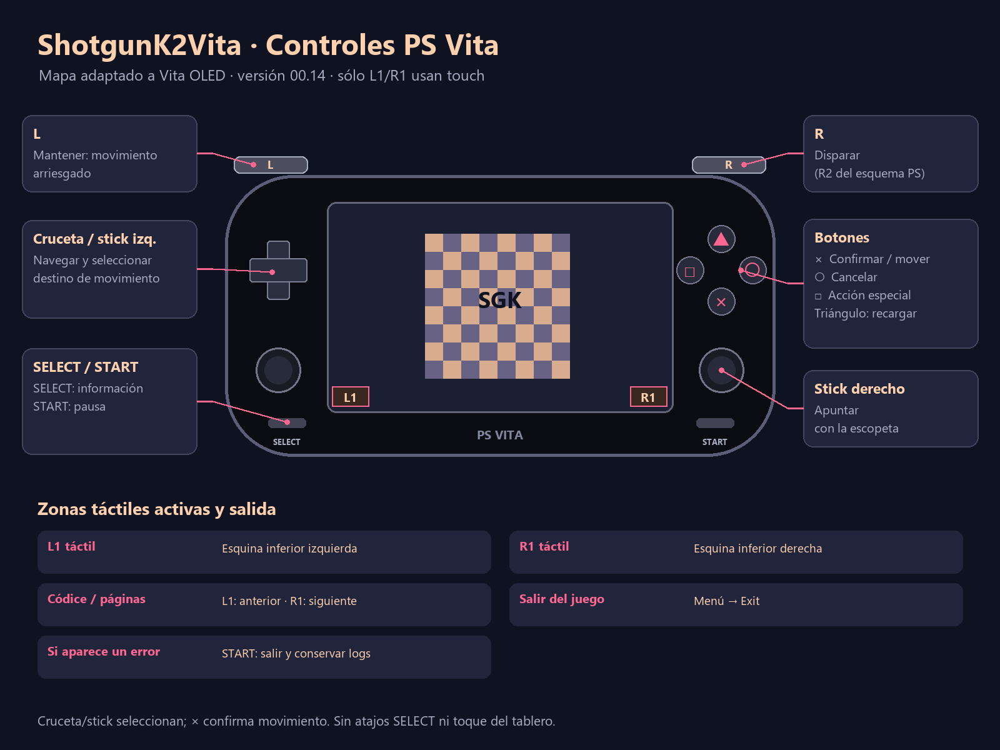

# Iteración 12 — Frame Budget (00.12)

## Actualizar desde 00.02 / instalación fallida de 00.03

Instalar `artifacts/iterations/00.12/ShotgunK2Vita-iteration12-frame-budget.vpk` desde VitaShell sobre el mismo título
`SGKV00001`. **Conservar `ux0:data/shotgunk2vita/` y su carpeta `save/`.**
No hace falta copiar otra vez el APK, `data.sgr` ni el ZIP de datos de 00.02.
La versión 00.03 incluye el icono del EXE y portada/gate del atlas del juego.
La versión 00.04 corrige el formato de estos PNG: índice de 8 bits, paleta
de 256 colores y sin transparencia. El error 0x8010113D comunicado por el
usuario coincide con el formato RGBA incompatible encontrado en 00.03.
Las dimensiones, CRC, paleta, XML y SFO se comprueban antes de entregar el VPK.
El usuario informa mejora considerable de FPS después de esa entrega,
pero un crasheo. La versión 00.05 registra diagnósticos persistentes para
localizar la causa; todavía no se considera corregido el crasheo.
El log recuperado del runtime anterior muestra `gamepad.lua:1994: attempt to
call global 'delta' (a nil value)`. La versión 00.08 registra `delta()` junto
a `dt()` y conserva los logs de 00.05. La prueba de regresión reproduce el
fallo previo y ahora mantiene/suelta cuatro direcciones de cruceta y stick.
Falta confirmar ese arreglo en la consola; otros errores siguen siendo posibles.

Las entregas anteriores se conservan en `artifacts/iterations/00.02/` y
`00.03/`, `00.04/` y `00.05/`; la compilación nueva está en `build-iterations/00.12/`.
No desinstalar ni borrar datos/saves para aplicar esta actualización.

Si es la primera instalación, extraer `shotgunk2vita-data.zip` y copiar su
carpeta `shotgunk2vita` a `ux0:data/`. Debe existir
`ux0:data/shotgunk2vita/code.lua`, `assets/`, `code/`, `libs/` y los `.sgimg`
junto a los PNG. El ZIP se prepara sin saves de pruebas de PC.

00.07 corrige `trifill()` ausente al inspeccionar piezas con el stick derecho.
La regresión de 5.400 frames pasa en PC; falta comprobarla en Vita.
[Detalle del diagnóstico](STATUS_ITERATION07.md).

00.08 añade disparo con sprites girados, puente SET para sliders, doble
framebuffer y composición en RAM. Probar R/recarga, opciones y parpadeo con
y sin HUD. No se considera estable hasta confirmar hardware y más partidas.
[Diagnóstico y límites](STATUS_ITERATION08.md).

## Controles

X confirma/mueve; círculo cancela; cuadrado es acción especial; triángulo
recarga. Cruceta/stick izquierdo navegan y seleccionan destino. Stick derecho
apunta. R dispara; L mantenido permite movimiento arriesgado. START pausa y
SELECT muestra información.

SELECT+L/R cambia páginas. SELECT+cuadrado/círculo suple L3/R3.
SELECT+triángulo ya no activa ningún medidor. START+SELECT sale.
Las combinaciones consumen el botón hasta soltarlo para evitar que al soltar
SELECT se produzca un disparo o una recarga accidental.

En los gráficos originales de PS pueden aparecer R2/L2: corresponden a R/L
físicos. La guía externa muestra el mapa adaptado. Elegir Throne, rank 1,
Solomon y START; avanzar las viñetas con X.

## Rendimiento y audio

Sin configuración, solicita CPU 444 MHz y tres participantes para presentación.
El trabajo de Lua sigue en un hilo. Audio funciona en un hilo prioritario
independiente, con MP3 por streaming y mezcla WAV PCM16 estéreo a 44,1 kHz.
Se usa el patrón de dos buffers de la implementación de música de Touhou 7.5.

Nuestro contador se ha retirado, incluso con hud=1 en configuraciones antiguas.
CSV y logs conservan FPS y tiempos de lógica/dibujo/presentación/copia/espera.
[Herramienta de rendimiento](PERFORMANCE_TOOL.md) explica perfiles balanced,
single y battery, y la generación de informes HTML.

Las pruebas de PC alcanzan partida activa, comparan imágenes idénticas con
uno/tres hilos y verifican cinco minutos de audio mezclado, pista A→B y bucles.
Falta confirmar en Vita la mejora de FPS, sonido audible, latencia y estabilidad.
Audio OGG de la intro alternativa, crossfade completo, canales musicales
simultáneos, shaders/CRT y compatibilidad de todas las cartas/modos siguen
pendientes. Las partidas antiguas codificadas no se importan.

## Qué enviar después de probar

Después de reproducir el fallo, copiar toda la carpeta:

- `ux0:data/shotgunk2vita/logs/`
- El `.psp2dmp` reciente en `ux0:data/`, si Vita lo genera.

Las sesiones ya no se sobrescriben al volver a abrir el juego. Dentro de cada
una están `runtime.log`, `audio.log`, `performance.csv` y `crash-trace.log`.
[Guía de recuperación y ZIP de diagnóstico](CRASH_LOGS.md).

Informar FPS en título/menú/tablero, si se oye música y efectos, y si los
controles responden. Si hay cierre o pantalla de error, conservar también
el código de error y describir la última pantalla.

[Roadmap y límites de la evidencia](ROADMAP.md).

## Prueba de 00.09

Abrir y cerrar pausa con START, entrar en opciones y volver a la partida.
Probar R, triángulo y ambos sticks durante cinco minutos. Usar el plugin propio
para ver FPS; copiar la sesión completa al salir. Conservar datos y partidas.
El registro `copy_probe` identifica integridad y backend elegido. `copy_mode=2`
es automático; 0 fuerza CPU, 1 solicita DMA (con fallback si falla). Comparar
copy-cpu/copy-dma en el mismo recorrido, observando parpadeo y `copy_ms`.
No se ha comprobado todavía esta transferencia en una consola física.

## Prueba de 00.10

Conservar datos y save/. Comparar el mismo recorrido de título/menú/tablero
con el plugin de FPS, manteniendo reloj/perfil igual. Probar ambos sticks,
cruceta mantenida, R, recarga y combinaciones SELECT. Abrir/cerrar pausa,
regresar al menú y elegir Exit: debe cerrar sin pantalla de error, dejando
exit_reason=menu_exit y sesión terminada en los logs. También funciona START+SELECT.
Recuperar la carpeta completa logs/00.10-* para media/P95 y los nuevos
input_calls/input_evaluations/input_parses. No forzar DMA en esta prueba:
00.09 falló integridad en el pase 6 y volvió correctamente a CPU.

L1/R1 táctiles: botones visibles en las esquinas inferiores del panel frontal.
Mantener equivale a mantener L1/R1; se pueden tocar ambos a la vez. Sus zonas
consumen el toque antes de pasarlo al tablero. SELECT+L y SELECT+R siguen siendo
alternativas físicas; L/R solos corresponden a L2/R2. No se añade un contador FPS.

## Prueba de 00.11

Instalar sobre SGKV00001 sin borrar ux0:data/shotgunk2vita ni save.
Recorrer título/menú/tablero 60–120 segundos, desbloquear un logro, revisar su
popup/lista después de reiniciar, probar L1/R1 táctiles, apuntado/disparo,
pausa/audio y Exit. Comprobar colores/texto, franjas y ausencia de flickering.
Enviar toda la nueva carpeta logs/00.11-... junto con los relojes del plugin.
Para comparar CPU, usar preset copy-cpu (renderer=0); repetir misma partida,
mismos relojes y escena. balanced restaura GPU. No forzar DMA corrupta.

Objetivo siguiente: acercar P95 a 33,3 ms para 30 FPS estables en juego;
60 necesita 16,7 ms. Sólo lógica+dibujo de esta sesión suman ~29,23 ms:
60 exige optimizar esas fases, además de la transferencia. 12 Frame Budget
perfilará las rutas dominantes después de recibir la medición GPU.

## Prueba de00.12

Instalar sobre SGKV00001 conservando ux0:data/shotgunk2vita y save.
Probar desaparición de enlaces externos, nombre legible del logro al finalizar
un piso, Códice/Logros tras reiniciar, R1/L1 táctiles, pausa, audio y Exit.
Medir título y misma partida durante60–120s con mismos relojes; enviar carpeta
logs/00.12-... completa y captura si el aviso sigue incorrecto.

Próxima13 — Draw Budget: perfilar primitivas y callbacks dominantes en la partida
una vez cuantificada la reducción real de present_ms. Mantener media/P95,
controles, audio y estabilidad; no compresión de archivos como sustituto de
reducir trabajo de dibujo. No HUD propio.
